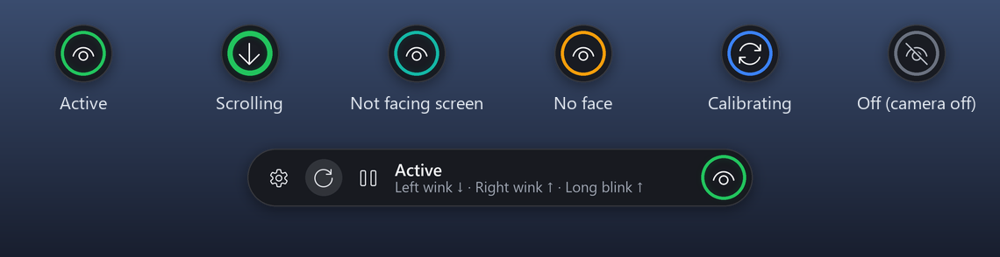
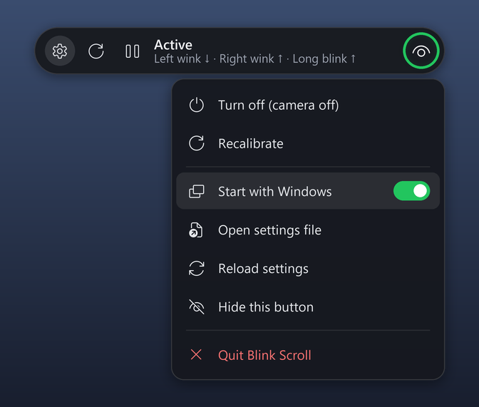

# Blink Scroll

[](https://github.com/hasanmahdi2007/blink-scroll/actions/workflows/tests.yml)   [](LICENSE)

**Scroll any window hands-free with your eyes.** Blink Scroll watches you through your laptop
webcam and scrolls the window under your mouse cursor when you make a deliberate eye gesture.
**Hold a wink, and the page keeps scrolling for as long as you hold it.** Normal blinking, reading
and looking at your keyboard are ignored.



- **Private.** Everything runs on your computer. Camera images are never saved or sent
  anywhere. The only internet use is a one-time 3.7 MB model download during setup.
- **Light on battery.** About 2-3% of total CPU while you use it, under 1% when nobody is in
  front of the camera, and **0% with the camera off** when you switch it off or lock Windows.
- **No training.** It uses Google's pretrained MediaPipe face model plus ordinary logic.
- Works with glasses.

## Install (Windows 10 / 11)

1. **[Download `BlinkScroll-Setup.exe`](https://github.com/hasanmahdi2007/blink-scroll/releases/latest)**
   (about 70 MB) from the latest release.
2. Run it. You can choose a desktop shortcut and "start when Windows starts". Nothing else is
   needed: no Python, no admin rights.
3. Blink Scroll starts, and a round button appears on the right edge of your screen.

Afterwards, open it like any app: **Start menu → Blink Scroll**, or the desktop shortcut.
Uninstall it from **Settings → Apps**.

> **"Windows protected your PC"?** The installer isn't code-signed (a certificate costs money),
> so SmartScreen warns about any new app from a small publisher. Click **More info → Run
> anyway**. The source code is all here, and the installer is built from it automatically by
> GitHub ([release workflow](.github/workflows/release.yml)).

<details>
<summary>Alternative: run from source (for developers)</summary>

1. Download or `git clone` this repo into a permanent folder.
2. Double-click **`install.bat`**. It installs Python 3.12 if needed (through `winget`), the
   packages into `.venv`, and the model.
3. Start it with **`run.bat`**. `debug.bat` and `tune.bat` are there too.

</details>

## First start: 6-second calibration

The button turns blue and shows instructions:

1. **Look at the screen with your eyes open** for 3 seconds.
2. **One beep:** close both eyes and keep them closed.
3. **Two beeps:** open them again. Done.

Calibration is saved. Run it again (the ↻ button) if you put on or take off glasses, the lighting
changes a lot, or detection feels off.

## How to scroll

| Gesture | Scrolls | |
|---|---|---|
| **Wink your left eye and hold it** | ↓ down | Starts after about ¼ s, speeds up the longer you hold, stops when you open the eye |
| **Wink your right eye and hold it** | ↑ up | The same |
| **Close both eyes for about 0.6 s and hold** | ↑ up | For people who can't wink their right eye (common) |

Point your mouse at the page you want to scroll, because scrolling goes to the window under the
cursor. Gestures only count while you face the screen. Looking down at the keyboard or turning
your head away is ignored.

You can change every gesture and its direction, turn on a *fast double blink*, or switch from
"scroll while held" to fixed jumps. See [Settings](#settings).

## The button



- **Hover** to expand it: status, **⏸ on/off**, **↻ recalibrate**, **⚙ settings**.
- **Click** the round button to turn it on or off. Off releases the camera, so the camera light
  goes out.
- **Drag** it up or down the edge, or to the other side of the screen.
- It **tucks itself away** to a thin sliver at the screen edge. Touch the sliver and it slides
  out.
- **Colours:**

| Colour | Meaning |
|---|---|
| green | active |
| teal | you're not facing the screen, so gestures are ignored |
| amber | no face; after 10 s it drops to low-power mode |
| blue | calibrating |
| grey | off, camera released |
| red | camera unavailable (used by another app?); it retries automatically |

- The same menu is in the **tray icon**. If you hide the button, the tray brings it back.

**Keyboard shortcuts:**

| Shortcut | Action |
|---|---|
| `Ctrl+Alt+B` | on / off |
| `Ctrl+Alt+C` | recalibrate |
| `Ctrl+Alt+Q` | quit |

Windows being locked also turns the camera off automatically, and it comes back on when you
unlock.

## Settings

Everything is in **`config.toml`** (⚙ → *Open settings file*). Edit it, save, then choose
⚙ → *Reload settings*; no restart is needed. Delete the file to restore the defaults.

| What | Setting |
|---|---|
| Gestures on/off | `gestures.wink.enabled`, `gestures.long_blink.enabled`, `gestures.double_blink.enabled` |
| Directions | `gestures.wink.left_direction` / `right_direction`, `gestures.long_blink.direction` (`"up"` / `"down"`) |
| Scroll speed while holding | `scroll.hold_start_notches_per_s` (default 4), `scroll.hold_max_notches_per_s` (12), `scroll.hold_ramp_s` (2) |
| One fixed jump per gesture instead | `scroll.hold_to_scroll = false`, size in `scroll.amount` |
| Long-blink length | `gestures.long_blink.min_duration_s` (0.6) |
| Left/right swapped? | `detection.swap_eyes = true` |
| Head turn / looking-down limits | `[head_pose]` section |
| Responsiveness vs. battery | `processing.idle_fps` (8) and `processing.fps` (20) |
| Hotkeys | `[hotkeys]` section |

### Tuning it to your eyes

People blink very differently, so there's a tuning kit:

1. Quit Blink Scroll, then start **Start menu → Blink Scroll (tuning session)** (`tune.bat` when
   running from source). It's a guided 3-minute session: read normally, then do each gesture
   when you hear the beeps. It saves only numbers (scores and head angles), never images, to
   `%LOCALAPPDATA%\BlinkScroll\recordings`.
2. See what your settings would have done with that recording (from source):
   `.venv\Scripts\python.exe -m blinkscroll.replay <recording.csv>`
3. Change `config.toml` and replay again until deliberate gestures trigger and reading doesn't.
   If you're not into that, open an issue with the recording attached and ask for help.

`BlinkScroll.exe --debug` (or `debug.bat`) opens a live view of your eye scores, thresholds, head
angles and every detected blink.

Settings, calibration and logs are stored in `%LOCALAPPDATA%\BlinkScroll` (the project folder
when running from source).

| Problem | Try |
|---|---|
| Scrolls by itself while reading | Recalibrate. Raise `gestures.long_blink.min_duration_s` (0.8). |
| Winks not recognised | Recalibrate. Lower `gestures.wink.closed_fraction` (0.3). Raise `open_eye_margin` (0.15) if your other eye squints. |
| Scroll stops while still winking | Raise `detection.release_s` (0.25). |
| Nothing works while facing the screen (teal button) | Head limits are too strict for how you sit: raise `head_pose.max_pitch_down_deg` / `max_look_down`. |
| Right wink never works | Many people can't wink that eye cleanly. Use the long blink for up (on by default). |

## Uninstall

**Settings → Apps → Blink Scroll → Uninstall.** Your settings stay in
`%LOCALAPPDATA%\BlinkScroll`; delete that folder too if you want everything gone. When running
from source, use `uninstall.bat`, then delete the folder.

## How it works

```
camera thread ──newest frame only──► processing thread (8 fps idle, 20 fps while an eye closes)
                                       ├─ MediaPipe FaceLandmarker → eyeBlinkLeft/Right, eyeLookDown,
                                       │                              head pose (yaw / pitch / roll)
                                       ├─ EyeTracker (eyes.py): smoothing → per-eye calibrated
                                       │   thresholds → hysteresis → blinks
                                       ├─ GestureEngine (gestures.py): facing-screen gate, wink / long
                                       │   blink / double blink, hold & release, cooldown
                                       └─ Scroller (actions.py): wheel events to the window under cursor
main thread: Tk event loop → floating button (per-pixel-alpha window), tray, hotkeys
```

- **Calibration per eye, open *and* closed.** With glasses a fully closed eye may only score
  about 0.45 instead of about 1.0, so fixed thresholds fail. Thresholds sit a fixed fraction
  of the way between your own open and closed levels.
- **False-trigger defences:**
  - a long blink needs one continuous, nearly full closure (two quick natural blinks don't add
    up to one)
  - looking down at the keyboard lowers the lids only about 55-75%, so it doesn't count
  - a wink needs the other eye clearly open
- **Facing-screen gate:** gestures are ignored while your head is turned or lowered, or your
  eyes look down. Angles are measured relative to your own posture, which the app follows
  slowly. The gate is judged from just *before* a gesture starts, because closing the eyes
  confuses gaze estimates.
- **Hold and release:**
  - scrolling ramps from 4 to 12 notches/s
  - a release needs 0.15 s of open eye, so one noisy frame doesn't stop it
  - there's a 20 s safety limit
- **Power:**
  - the model costs a fixed ~13 ms per frame, so the frame rate decides CPU use; it runs at
    8 fps while your eyes are open and jumps to 20 fps when one starts to close
  - with no face for 10 s it drops to 4 fps
  - off or locked releases the camera entirely

### Measured (Windows 11 laptop, face in view unless noted)

| Mode | CPU, one core | CPU, whole machine |
|---|---|---|
| Active, adaptive 8 → 20 fps (default) | 17-22% | 2.2-2.8% |
| Active, fixed 20 fps | 34-37% | 4.3-4.6% |
| No face, low-power 4 fps | 6-7% | <1% |
| Off / Windows locked (camera released) | 0% | 0% |

Tuned on labelled recordings of a real user with glasses:
- **long blink:** 12/12 detected
- **left wink:** every clean wink detected
- **false scrolls:** 0-1 across 200 s of reading, keyboard use and head turning

The fast double blink is off by default because, for that user, natural blink pairs while
reading looked too much like deliberate double blinks (only 2 of 11 attempts were caught).

## Development

```
.venv\Scripts\python.exe -m pip install -r requirements-dev.txt
.venv\Scripts\python.exe -m pytest                       # 70 tests: gesture engine, holds, rendering, ...
.venv\Scripts\python.exe -m tests.manual_scroll_check    # real wheel events into a test window
.venv\Scripts\python.exe -m tools.make_readme_images     # regenerate the README images
```

**Releasing:**
1. Bump the version in `packaging/version_info.txt`.
2. Push a tag such as `git tag v1.2.0 && git push origin v1.2.0`.
3. GitHub Actions runs the tests, builds `BlinkScroll.exe` with PyInstaller
   (`packaging/blinkscroll.spec`) and the installer with Inno Setup (`packaging/installer.iss`),
   then attaches `BlinkScroll-Setup-<version>.exe` to the release.

To build locally, run PyInstaller on the spec, then `ISCC.exe packaging\installer.iss`.

| Module | Does |
|---|---|
| `camera.py` | capture thread |
| `landmarks.py`, `pose.py` | MediaPipe → `Sample` |
| `eyes.py`, `gestures.py` | pure, unit-tested logic |
| `actions.py` | scrolling |
| `pipeline.py` | processing loop, adaptive fps, pause |
| `controls/` | button (`look.py` drawing, `layered.py` window, `widget.py` behaviour), tray, hotkeys |
| `app.py` | wiring |
| `config.py` | settings |
| `recorder.py`, `replay.py`, `guided.py` | tuning kit |
| `system.py` | lock detection, single instance, autostart |

## License

[MIT](LICENSE)
